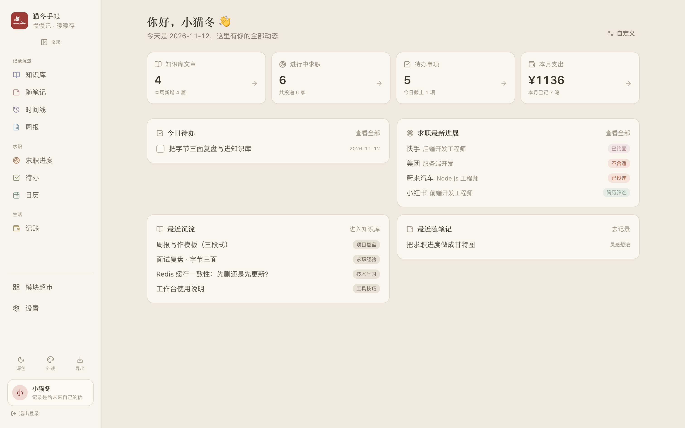
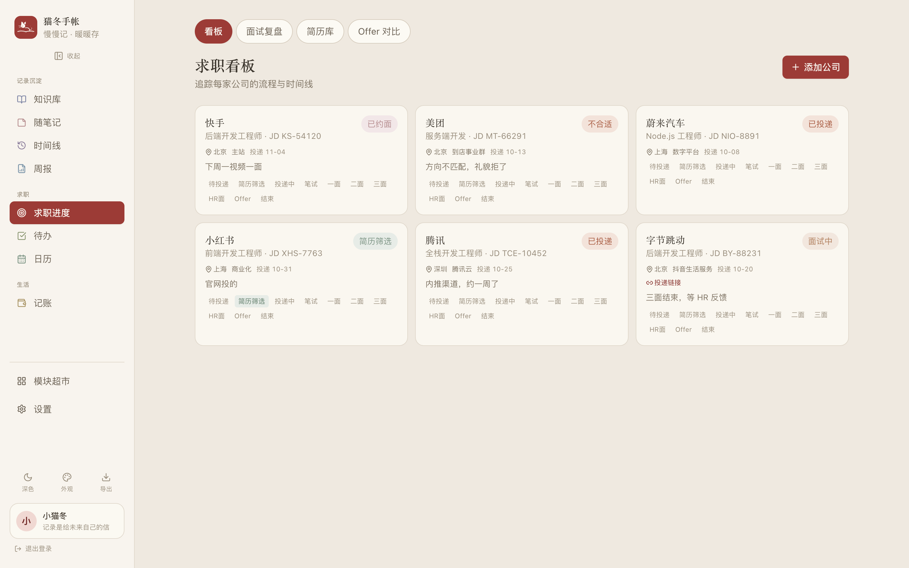
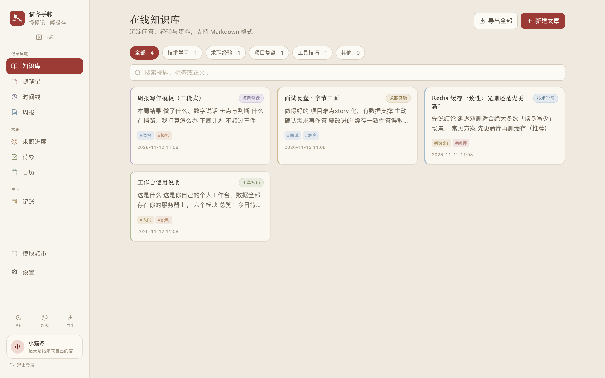
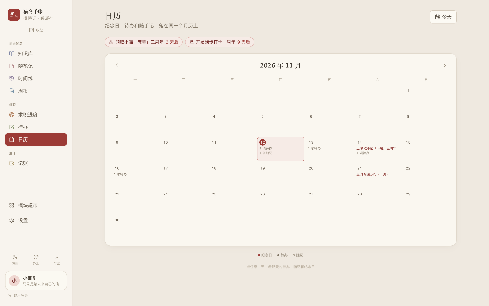
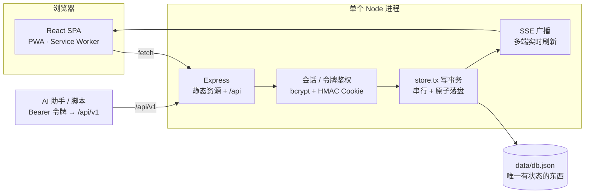

# 猫冬手帐 · Maodong Workbench

[](https://github.com/HollyLab0529/maodong-workbench/actions/workflows/ci.yml)
[](https://github.com/HollyLab0529/maodong-workbench/releases)
[](LICENSE)
[](https://nodejs.org)
[](CONTRIBUTING.md)

> 一个自托管的个人生活 / 求职工作台。纯 Node + Express + JSON 文件存储,零外部服务依赖——`npm install && npm start` 就能跑,备份就是拷走一个目录。

## 界面预览

<table>
  <tr>
    <td width="100%"></td>
  </tr>
  <tr>
    <td width="34%"></td>
    <td width="33%"></td>
    <td width="33%"></td>
  </tr>
</table>

> 图中均为演示数据。还有待办四象限、记账趋势、随笔记、模块超市等 20+ 模块，按下面「快速开始」三条命令就能看到自己的。

## 它是什么

一套给自己用的「第二大脑 + 求职指挥台」:

- **知识库** —— Markdown 文章管理,分类配色 + 标签 + 全文搜索,单篇/整批导出 `.md`
- **求职深水区** —— 投递看板、面试复盘、简历库(支持 PDF/DOCX 上传)、Offer 对比
- **待办** —— 四象限矩阵(格子名可自定义、支持格子内快速添加)、优先级、具体时间与地点
- **账号管理** —— 各平台账号密码集中记,默认打码、一键复制、强度判定、重复密码检测、随机密码生成
- **过期提醒** —— 调料 / 化妆品的到期日与倒计时,临期推送浏览器通知
- **书影音 / 阅读笔记** —— 书影音条目 + 评分笔记,支持导出书单 `.md`
- **习惯打卡 / 健身 / 体重 / 睡眠 / 订阅 / 旅行 / 菜谱 / 记账**(预算 + 趋势图)
- **时间线 / 日历**(月视图 + 纪念日)、**总览 Dashboard** —— 今日焦点 + 各模块趋势
- **模块超市** —— 模块按需装卸、拖拽排序;「灵感池」可向开发者提需求
- **个性化** —— 五套配色 + 暗色模式、标题/正文字体独立可选、侧栏可折叠可拖拽调宽
- **PWA**:可安装到手机桌面,离线打开壳,多端实时同步(SSE)

### 特色:AI 助手接入层

内置 Bearer 令牌鉴权的开放 API(含接口文档页 `/apidoc`)。在设置页生成令牌后,任何 AI 助手或脚本——CatPaw、Claude Code、iOS 快捷指令、你自己的 Agent——都能直接读写你的手帐:

```bash
curl -X POST http://localhost:3031/api/data/kb_articles \
  -H "Authorization: Bearer <你的令牌>" \
  -H "Content-Type: application/json" \
  -d '{"title":"标题","category":"技术学习","tags":"标签","content":"Markdown 正文"}'
```

多令牌 + 读写 scope 设计:给只读分析脚本和可写助手分别签发,泄露可单独吊销。

## 快速开始

```bash
git clone https://github.com/HollyLab0529/maodong-workbench.git
cd maodong-workbench
npm install
npm run build          # 等价于 cd web && npm ci && npm run build，产物输出到 public/
npm start              # http://localhost:3031
```

首次打开会引导注册,第一个注册的账号自动成为「创作者」(可看全站灵感池),之后注册需要 8 位邀请码(在设置页生成)。

## 部署方式

两条路线,选一条:**有服务器**(VPS + 域名,systemd + nginx + HTTPS)或 **没有服务器**(Docker / PaaS / 内网穿透,只需挂持久卷)。详细逐步说明见 **[docs/DEPLOY.md](docs/DEPLOY.md)**;想让 AI Agent 代劳,直接把仓库 + **[AGENTS.md](AGENTS.md)** 交给它。

| 方式 | 适合人群 | 说明 |
|---|---|---|
| 本地运行 | 想先试用 | 上面的快速开始即可,数据在本机 `data/` |
| VPS + 系统服务 | 正式自托管 | `deploy/deploy.sh`(rsync + systemd 模板):先把 `SERVER` / `KEY` / `REMOTE_DIR` 写进 `deploy/deploy.local.sh`(已 gitignore),再 `zsh deploy/deploy.sh`;建议配 nginx 反代 + HTTPS |
| Docker Compose | 有 Docker 环境 | `docker compose up -d --build`,数据挂载在 `./data`;或直接用现成镜像 `docker run -d -p 3031:3031 -v ./data:/data ghcr.io/hollylab0529/maodong-workbench:latest`(发版后可用) |
| 一键 PaaS(Railway / Zeabur 等) | 没有服务器 | 注册即送子域名;**注意挂持久卷**,否则重新部署会丢 JSON 数据 |
| 交给 AI Agent | 都不熟 | 见 `AGENTS.md`(验收标准、常见失败、回滚都写好了) |

> 克隆后先跑 `zsh scripts/install-git-hooks.sh`,装上防泄密钩子(拦截 `data/`、令牌、服务器配置误提交)。

### 环境变量(可选)

| 变量 | 作用 |
|---|---|
| `PORT` | 服务端口,默认 `3031` |
| `DATA_DIR` | 数据目录,默认 `./data` |
| `OWNER_EMAIL` | 指定「创作者」账号邮箱(默认第一个注册账号),用于查看全站灵感池 |
| `VITE_SITE_BASE` | 构建前端时注入作品集站点地址,用于「反馈」页跳转链接(不配则隐藏) |

### 数据与隐私

- 所有数据只存在 `data/db.json`(按 `user_id` 隔离),备份 = 拷走 `data/` 目录
- 「账号管理」模块里的密码是**明文存储在 JSON 文件**中的,仅靠登录会话与文件权限保护——**没有端到端加密**。不要用它存银行/支付类高危密码,或用系统钥匙串 / 密码管理器保管主密码
- 公网部署务必走 HTTPS,并限制 `data/` 目录的访问权限

> ⚠️ **安全提示**:默认配置只适合本机/内网。公网部署请务必:① 走 HTTPS(令牌是明文 Bearer);② 定期备份 `data/` 目录(所有数据都在里面,包括 `.secret`——它丢了令牌体系就要重置)。

## 技术栈

- **后端**:Node 18+ / Express,JSON 文件存储(`data/db.json`,串行写事务 + 原子落盘),HMAC 签名令牌鉴权,SSE 实时推送
- **前端**:React 18 + Vite + Tailwind,五套主题配色 + 暗色模式,⌘K 全局搜索
- **部署**:单进程单目录,无数据库依赖;Docker / systemd / PaaS 均可



## 项目结构

```
server/     Express 入口与路由(index.js)、AI 解析(ai.js)、JSON 存储与写事务(store.js)
web/        React + Vite 源码(npm run build 输出到仓库根的 public/)
public/     前端构建产物,git 忽略,不构建就没有
scripts/    敏感信息扫描、图标生成、git hooks 安装
deploy/     deploy.sh(rsync 部署)、workbench.service.tpl(systemd 单元模板)
 docs/      DEPLOY.md(两条部署线)
data/       运行时数据,git 忽略 ★ 备份只需要它
```

## 文档索引

| 文档 | 给谁看 |
|---|---|
| [docs/DEPLOY.md](docs/DEPLOY.md) | 人类部署：有服务器 / 没服务器两条线 |
| [AGENTS.md](AGENTS.md) | AI Agent 部署：命令序列、验收标准、常见失败、回滚 |
| [CONTRIBUTING.md](CONTRIBUTING.md) | 想提 PR：开发环境、代码约定、新增集合必改的三处 |
| [SECURITY.md](SECURITY.md) | 报漏洞的私密渠道 + 已知安全边界 |
| [CHANGELOG.md](CHANGELOG.md) | 版本变化 |

## License

[MIT](LICENSE)
