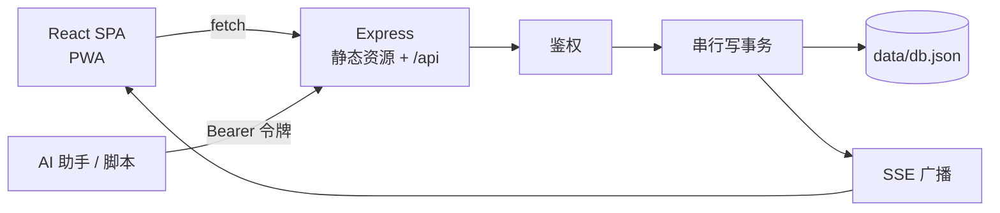

# 我给自己写了一个自托管工作台：架构取舍与四个真实踩坑

> 起因很简单：我的生活数据分散在七八个应用里——求职投递在表格、笔记在文档、记账在 App、待办在另一个 App、日历又是另一个。每换一次工具就搬一次家，而我的 AI 助手想读写这些数据，几乎没有一个是开放的。
>
> 于是我花了几周，写了一个纯 Node 的单进程应用：**猫冬手帐**。它现在跑在我自己的服务器上（也有公开演示站），代码 MIT 开源在 [maodong-workbench](https://github.com/HollyLab0529/maodong-workbench)。这篇不写功能清单，只写三件工程上的取舍和四个把我绊住的坑。

## 一、先定约束，再定架构

开工前我只允许自己有三个硬约束：

1. **一条命令能跑起来**：`npm install && npm start`，不装数据库、不配 Redis、不拉 Docker。
2. **备份必须是人能理解的**：用户敢自己动手备份，才敢长期用。
3. **AI 助手是一等公民**：不是"以后加个 API"，而是第一天就要有鉴权、scope、文档的开放接口。

这三条约束把架构逼到了唯一解：



整台"服务器"就是一个 Node 进程，唯一有状态的东西是 `data/db.json`。删掉这个进程，拷走这个目录，你的全部数据就在手上——这就是我想要的自托管。

**为什么不上 Postgres？** 因为我的数据量是"几千条记录"级别，JSON 全量读进内存大约几 MB，查询用 `Array.filter` 比写 SQL 还快，而且省掉了一个必须常驻的容器。这是一个明确的、有上限的选择：等到单文件超过几百 MB 或者需要多进程写，架构就得换。**知道自己架构的失效边界，比假装它能一直用下去更重要。**

## 二、单文件存储的两个关键实现

### 写事务：串行 + 原子落盘

JSON 文件做存储，最大的风险不是性能，是**并发写把文件写坏**。我的解法只有二十行：

```js
// 写事务：串行执行，避免并发写坏文件
function tx(fn) {
  const run = queue.then(async () => {
    const db = ensure();
    const result = await fn(db);
    await persist();      // 先写 db.json.tmp，再 rename 覆盖
    version += 1;
    broadcast();          // 只广播一个版本号
    return result;
  });
  queue = run.catch(() => {});
  return run;
}
```

两个要点：

- **串行**：所有写操作挂在同一条 Promise 链上，永远只有一个写者。
- **原子落盘**：`writeFile(db.json.tmp)` → `rename(tmp, db.json)`。`rename` 在同分区上是原子的，进程在任意时刻被 kill，磁盘上要么是旧文件、要么是新文件，**不存在半个 JSON**。

我给这条链路写了一个用例：并发发起 20 个写请求，断言 20 条都落盘、id 不重复。这类测试跑一次 10 秒，但省下来的排查时间是以小时计的。

### 多端同步：SSE 只推版本号

手机改了一条待办，桌面端要立刻看到。常见做法是 WebSocket 推全量数据——但这样一来，服务端就得知道"每个客户端关心什么"。

我选了更笨但更省心的方案：**SSE 只推一个自增版本号**，客户端收到后自己重新拉取。

```
data: {"v":137}
```

代价是多一次请求，收益是服务端零状态——不需要 diff、不需要合并、不需要处理乱序。在个人应用的数据量下，这个交换完全划算。

## 三、四个真实踩坑

### 坑 1：统计卡片上诡异的白色碎片（真 bug，被误判成截图问题）

总览页的统计卡片上一直有三条白色圆角横条，看起来像截图工具渲染故障。我一度把它归类为"环境问题"，用别的页面当配图绕过去了。直到某天我认真看了一眼 DOM：

```html
<a class="group rounded-xl border bg-white/80 p-4">
  <div>本周投递</div>
  <div>12</div>
  <div>较上周 +3</div>
</a>
```

问题在 `display`：`<a>` 默认是 **inline**。inline 元素带背景和内边距时，浏览器会按**行盒（line box）**切分绘制——三行内容就被画成三条独立的背景带，还因为 `padding` 上下溢出父容器 14px。

修复是一行：给 `className` 加上 `block`。

**教训**：`inline` 元素上不要同时用背景色 + padding 做卡片。更普遍的教训是——**当"这不可能是代码问题"的直觉出现时，恰恰是最该打开 devtools 的时候**。我把这个伪影误判了三天。

### 坑 2：依赖大版本升级被自己的测试拦住

dependabot 很勤快，某天提了一个 express 4 → 5 的 PR，CI 直接红：

```
Error: Missing parameter name at index 1: *
  at pathToRegexp (/node_modules/path-to-regexp/dist/index.js)
```

原因：express 5 换了 `path-to-regexp` v8，**不再支持裸 `*` 通配路由**，必须写成 `/{*splat}` 这类具名通配。我的 SPA fallback 路由 `app.get('*', ...)` 正好命中——服务**启动即崩**，接口测试全部超时。

这件事的价值不在"修 express 5"，而在于：**如果这个 PR 被静默合入，用户 `git pull` 之后服务就再也起不来**。而我的 12 个接口用例第一句话就是"起一个真实服务进程 + 探活"，所以它在合并前就红了。

处理方式：在 `dependabot.yml` 里给 npm 分组加 `ignore: semver-major`。大版本升级由人评估，小版本放行。**自动化的价值不是替代人，是把问题挡在你看见之前。**

### 坑 3：本机镜像污染了 lockfile

CI 又红了一次，报 `ENOTFOUND r.npm.internal`——一个外网环境根本访问不到的内网镜像地址。

根因：我本机配了内网 npm 镜像加速，某次 `npm install` 生成的 `package-lock.json` 里，`resolved` 字段被写成了内网地址。它在我机器上一切正常，到 GitHub Actions 就装不上。

治标是重生成 lockfile；治本是在仓库里加一个**项目级 `.npmrc`**：

```
registry=https://registry.npmjs.org/
```

项目级配置会覆盖用户级配置，从此不管谁在什么网络环境跑 `npm install`，lockfile 里的地址都是公共源。

**教训**：`package-lock.json` 是可移植性契约，它记录的不只是版本，还有**你当时的网络环境**。任何会进这个文件的全局配置，都值得在项目里显式钉死。

### 坑 4：演示站要"能随便点"，但不能"被随便炸"

我想给项目做一个公开演示站，但有两个矛盾需求：访客要能真的改数据（只读演示没意义），而数据被改乱了演示就废了。

三道防线：

1. **禁止注册**：只开放一个演示账号，注册接口直接 403。
2. **禁止签发 API 令牌**：否则任何人拿到令牌就能绕过前端疯狂写。
3. **写操作按 IP 限流** 60 次/分钟：GET 全放行（不影响浏览），写超限返回 429 + `Retry-After`。内存里一张 `Map` 记录，超 5000 个 IP 时顺手清理过期项——不需要 Redis。

再加一条兜底：**每天凌晨 4 点用 seed 快照覆盖整个数据目录并重启**。所以无论前一天被改成什么样，第二天都是干净的。

有意思的是第三点的边界：限流器必须放行 `GET`/`HEAD`/`OPTIONS`，否则会话轮询都会被 429，页面直接白屏。**限流的第一原则是想清楚"什么不算写"。**

## 四、性能：首屏从 493KB 到 264KB

项目有 25 个页面，一开始所有页面打进一个 bundle，首屏 493KB（gzip 144KB）——对一个"打开看今天要干什么"的首页来说太重了。

改了两处：

**路由级懒加载**：Dashboard 保持同步（首屏必须立刻有内容），其余 24 个页面 `React.lazy` + 一个 `Suspense` 兜底。各页从此独立成 chunk，只有点进去才下载。

**vendor 分包**：

```js
manualChunks(id) {
  if (!id.includes("node_modules")) return;
  if (id.includes("react-router")) return "router";
  if (id.includes("react") || id.includes("scheduler")) return "react";
  return "vendor";
}
```

注意这里是**函数形式**。我一开始用了对象形式的 `{ react: ["react", "react-dom"] }`，构建产物里 react chunk 只有 0.03kB——对象形式匹配不上时不会报错，只会静默地不生效。**凡是"配置了但好像没效果"的构建选项，都要去产物里核实一遍。**

结果：首屏 493KB → 264KB，gzip 145KB → 83KB，**减少约 43%**。而且因为框架代码单独成块，日常改业务代码时，浏览器里 react/router 的缓存永远命中。

## 五、给它加上"不可破坏的骨头"

自托管应用最怕的不是功能少，是**数据错乱**。所以我用 Node 内置的 `node:test` 写了 12 个用例，零新依赖，10 秒跑完，每个用例都起一个真实服务进程 + 临时数据目录、走真实 HTTP：

- 未登录必须 401；字段白名单（`user_id` 不能被请求体冒充）
- A 用户看不到 B 用户的数据；导出只包含本人数据
- 20 并发写不丢数据、id 不重复
- 只读令牌写数据必须 403
- 杀掉进程重启，数据还在
- 演示模式下：注册 403、令牌 403、第 61 次写 429

这些测试的价值在坑 2 已经体现过一次了：**它们守的不是"代码有没有 bug"，是"这个应用还能不能安全地给别人用"。**

## 六、它的边界（写在前面比藏在后面好）

- 「账号管理」模块里的密码是**明文存 JSON** 的，只靠会话和文件权限保护，**没有端到端加密**。它适合存"这个站我注册过"的信息，不适合存银行密码。
- 单文件存储适合个人量级。要到多人协作、几十万条记录，得换数据库。
- 公网部署必须走 HTTPS，`data/` 目录（含 `.secret`）必须定期备份——它丢了，令牌体系就要重置。

## 最后

写这个东西最大的收获不是多了一个工具，是重新理解了"自托管"三个字：**它不是把数据从别人的服务器搬到自己的服务器，而是让备份、迁移、二次开发都变成你自己能完成的动作。**

项目开源在 [HollyLab0529/maodong-workbench](https://github.com/HollyLab0529/maodong-workbench)（MIT），有演示站、有一键部署脚本、有 Docker 镜像，也有一份给 AI Agent 看的 `AGENTS.md`——你可以把它连同仓库交给助手，让它帮你部署。

如果你也在做类似的东西，欢迎交流；如果你踩过我踩的坑，那这篇就没白写。
